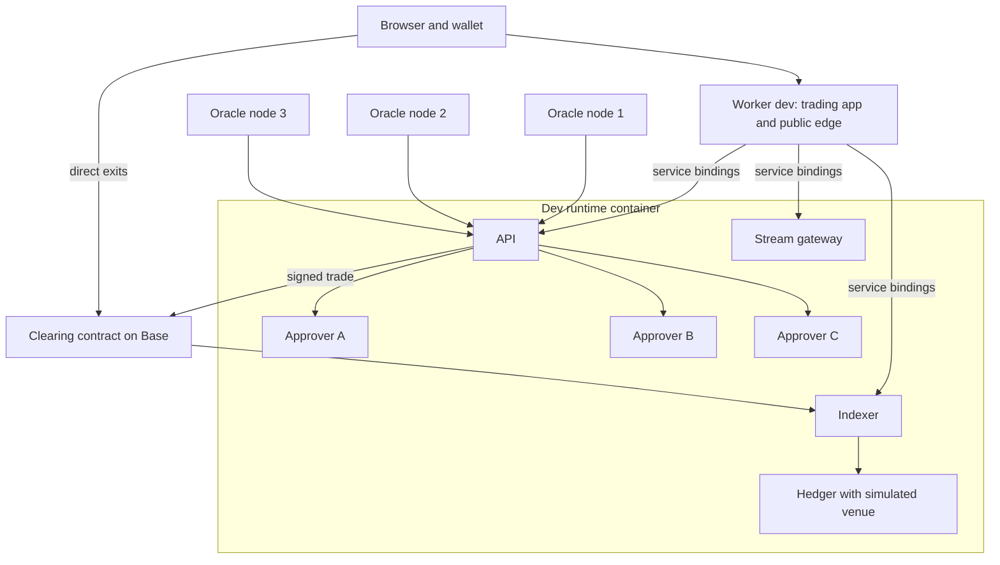

# Architecture overview

RFQ Markets is a leveraged perpetuals venue on Base. Traders hold USDC in one clearing contract. One operator quotes every trade and takes the other side. Three approvers co-sign each quote, and the contract settles it only with two of their signatures. The contract is the ledger: every balance and position can be rebuilt from its events.

This page describes the system as it runs in October 2026. The production layout is different, and the gap is tracked in the [implementation plan](../release/implementation-plan.md).

## What runs where

There is one deployment today: a development deployment on Base mainnet. It is owner-controlled, has no timelock and is capped at 25 USDC per trade and 100 USDC net per market. It must not hold customer funds. Everything except the contracts runs on Cloudflare.

| Component | Code | Where it runs in dev |
| --- | --- | --- |
| Clearing contract | `contracts/RFQClearing.sol` and its linked libraries, behind a transparent proxy | Base mainnet, proxy `0x6e67c66f955D88EBD6D69eD3343359651C6f45a1` |
| Oracle adapter | `contracts/oracle/SignedPriceOracle.sol` | Base mainnet, called only by the clearing contract |
| Oracle nodes 1, 2, 3 | `services/oracle-node` | Three Workers (`oracle-1`, `oracle-2`, `oracle-3`) with one container each, placed near western North America, western Europe and Asia-Pacific |
| API | `services/api` | Dev runtime container |
| Approvers A, B, C | `services/approver` | Dev runtime container, loopback only |
| Indexer | `services/indexer` | Dev runtime container |
| Stream gateway | `services/gateway` | Dev runtime container |
| Hedger | `services/hedger` | Dev runtime container, with the local simulator as its venue. Nothing is sent to Hyperliquid. |
| Trading app | `apps/web` | Worker `dev`, which is also the public edge for service routes |
| Public docs | `apps/docs` | Worker `docs` |
| Direct exit page | `apps/exit` | Worker `exit`, built for the dev clearing address |
| Hedge dashboard and internal docs | `apps/admin`, `apps/internal-docs` | Workers `admin` and `internal-docs`, behind Cloudflare Access |

The API, approvers, indexer, gateway and hedger share one Cloudflare Container behind the Worker `rfq-markets-runtime-dev`. That Worker has no public route. The trading app's Worker reaches it through service bindings. The liquidation keeper (`services/keeper`) is built and tested locally, but the dev runtime does not start it.

The runtime's Durable Object generates the approver, sponsor and emergency keys on first start and keeps them in its own storage. Each oracle node does the same for its signing key. Only the addresses leave Cloudflare. Container disk is ephemeral, so the Durable Object snapshots the SQLite journals every minute and restores them on start. A crash can lose up to a minute of journal. The contract still enforces nonces, signatures and caps, so that loss is operational. It is not a way around the checks.

Hosting is described in [Cloudflare hosting](../operations/cloudflare.md), with the step-by-step in the [dev environment guide](../../deploy/cloudflare/DEV-ENVIRONMENT.md). Contract deployment and the dev caps are in [Base mainnet deployment](../operations/base-mainnet.md).

## Trade flow

The app opens on Up / Down (Home, `/updown/<market>`): an amount, a multiplier and two buttons. Pro (`/trade/<market>`) is the full terminal, with limit and stop orders. Both use the same flow.

1. **Prices.** Each oracle node streams top-of-book from several exchanges, takes a median mid and signs a price batch about once a second. The API combines the latest batch from each node into one report. See [Price oracle](oracle.md).
2. **Indication.** The browser gets one shared pricing frame over Server-Sent Events and works out the price for the typed amount itself. Watching and typing reserve nothing. See [Scale and streaming](scale-and-streaming.md).
3. **Quote.** On tap, the app asks the API for a firm quote. The API prices it from the oracle report, the market spread, settled inventory and every open reservation. There is no trading fee. The platform earns a 2 bps markup that is part of the quoted price. The API reserves the trade's exposure before any approver can sign. See [Gross approval reservations](gross-approval-reservations.md).
4. **User signature.** The user signs an EIP-712 intent: account, market, size, limit price, nonce, deadline and reduce-only flag. The app checks the payload against what the user asked for. The build pins the chain, clearing contract and USDC token. With one-tap trading, a session key signs instead of the wallet (see below).
5. **Approvals.** The API asks all three approvers at once and stops at the first two matching signatures. Each approver checks the quote on its own: price against the oracle report, quote age (at most 8 seconds), exposure and hedge limits. It records the approval in its journal before it returns a signature.
6. **Settlement.** The API's gas sponsor submits the bundle. The contract checks the user's authority, two distinct current approvers, the leader epoch and policy versions, the oracle report, the limit price, margin, maker capital, caps and stress. Then it settles. The sender has no authority of its own: anyone could submit the same signed bundle.
7. **After settlement.** The indexer turns clearing events into account and history views. The hedger reads finalized exposure and hedges it, which in dev means the simulator. See [Indexer](indexer.md) and [Hedging](hedging.md).

### One-tap trading

One-tap trading uses a contract session key. The app generates the key in the tab and keeps it in memory only. The owner signs one grant (`grantSessionWithSignature`), which the API sponsors. The contract limits the session's markets, per-trade size, total size and expiry (at most 30 days). The app asks for 4 hours, twice the largest market's per-trade cap per trade and 40 times that in total, capped at 2,500 and 10,000 USDC. Approvers sign only for the newest session an account granted in the last 9,000 blocks, so a key left in an old tab stops trading once a newer one exists. A session key cannot withdraw, cancel, create another session or change authority. A trade over the limits goes back to the wallet. See [Wallets and deposits](wallets-and-deposits.md).

### Deposits and exits

Base USDC deposits can be gas-free: the wallet signs a USDC transfer authorization and the API sponsors it. Withdrawals are owner-signed intents that the API sponsors. A user can also withdraw, cancel nonces, revoke sessions and, while trading is paused, close positions from their own wallet. The exit page (`apps/exit`) does this without the API.

## Trust model

- **The contract is the authority.** It holds all collateral and positions. The API, approvers, indexer and edge cannot move funds by themselves.
- **Two of three approvers.** If one approver is down, two remain. One compromised approver cannot meet the threshold. Two compromised approvers can sign bad prices, but only within what the contract still checks: caps, margin, maker capital, stress and the oracle report. In dev, all three keys sit in one Durable Object and the approvers share a container, so dev has none of this independence.
- **Two of three oracle nodes.** The adapter needs signed batches from a majority of the configured nodes. It takes the median and skips any market where the nodes disagree or the price jumps. All three nodes run on one Cloudflare account. The [security review](../release/security-review.md) lists an open issue: whoever submits a report can choose which batches form it.
- **The operator is the counterparty.** Maker capital, insurance and the hedge account are kept apart. The contract counts only maker capital and insurance held on Base.
- **Governance.** In dev, one owner key controls governance and the ProxyAdmin, so upgrades and cap changes take effect at once. Production moves both to a 72-hour timelock run by a Safe. The emergency council can pause, disable a market and tighten limits. It cannot unpause, upgrade or move funds.
- **The edge.** Cloudflare can block or delay requests. It cannot create a user signature, an approver signature, an oracle report or a contract state change.

## Fail-closed checks

These checks refuse service rather than guess. Do not weaken them to make a test pass.

- The contract rejects a trade if any market with open positions has a price older than 15 seconds. A market without a fresh agreed price cannot trade.
- Approvers refuse quotes older than 8 seconds and check exposure and hedge state themselves, so a compromised API cannot get past them.
- A large hedge gap, an unhealthy hedger or a stale hedge snapshot puts the market into reduce-only.
- Oracle nodes answer 503 until the deployment record names their adapter and lists their address as a signer.
- The dev runtime refuses to run against a deployment whose approvers are not its own keys.
- The trading app refuses a `/v1/config` that names a different chain, clearing contract or USDC token, and signs only for the pinned contract.
- The public edge returns a structured 503 when a service binding or rate limiter is missing, 451 for blocked locations and 404 for unknown service routes. Private pages stay locked if Cloudflare Access is missing or misconfigured.
- The hedger cannot start on Base mainnet yet. Quotes return 503 there until that path is enabled on purpose.

## Detailed docs

Architecture:

- [Contracts](contracts.md): settlement order, margin, liquidation, resolution and authority.
- [Price oracle](oracle.md): the oracle nodes, the on-chain adapter and price history.
- [Economic specification](economic-specification.md): margin, funding, impact and the loss waterfall.
- [Gross approval reservations](gross-approval-reservations.md): how exposure is reserved before signing.
- [Hedging](hedging.md): venue capital, the hedge loop and reconciliation.
- [Indexer](indexer.md) and [read model and orders](read-model-and-orders.md): chain-derived account state and conditional orders.
- [Scale and streaming](scale-and-streaming.md), [wallets and deposits](wallets-and-deposits.md) and [edge and origin privacy](edge-and-origin-privacy.md).

Operations:

- [Local development](../operations/local-development.md): the full stack on a local chain.
- [Base mainnet deployment](../operations/base-mainnet.md): the dev and production profiles.
- [Cloudflare hosting](../operations/cloudflare.md) and the [dev environment guide](../../deploy/cloudflare/DEV-ENVIRONMENT.md).
- [Market lifecycle](../operations/market-lifecycle.md), [adding a market](../operations/adding-a-market.md) and [risk operator](../operations/risk-operator.md).

Release:

- [Implementation plan](../release/implementation-plan.md): what is done and what is open.
- [Release checklist](../release/release-checklist.md): the evidence needed before real capital.
- [Security review](../release/security-review.md): the October 2026 findings and open decisions.

## History

Earlier designs, audits and the retired Base Sepolia deployment are in [archive/history](../archive/history/). They explain how the system got here. Where they disagree with this page, this page wins.
